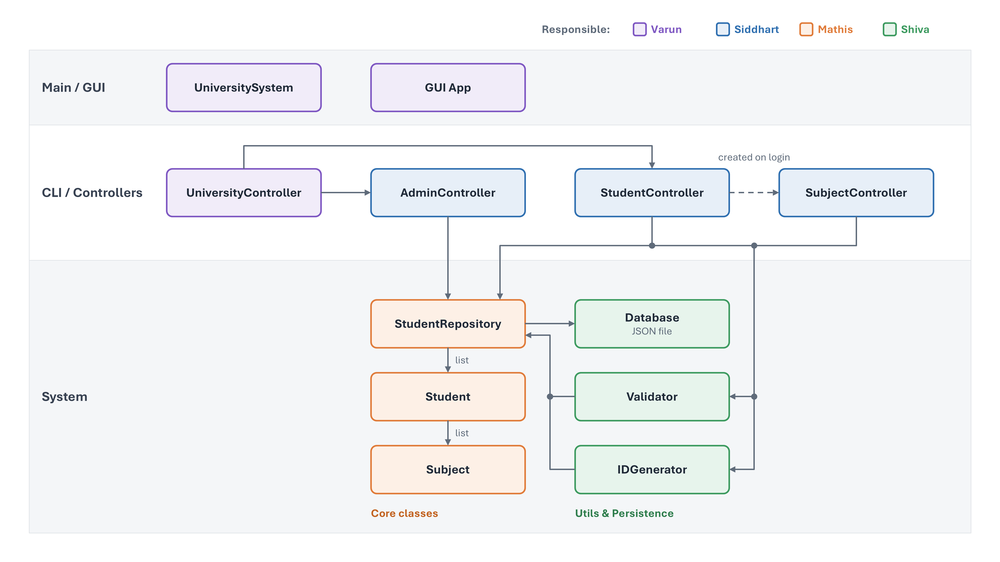

# Team Contributions

The work was divided by functional area, as illustrated below. Closely related components were assigned together so each team member could develop a coherent part of the application.

## Responsibilities

| Team member | Functional area | Main components |
| --- | --- | --- |
| Varun | Main application and GUI | Application startup, `UniversityController`, and the graphical interface |
| Siddharth | Controllers and CLI | `AdminController`, `StudentController`, and `SubjectController`, including their terminal interactions |
| Mathis | Core system classes | `StudentRepository`, `Student`, and `Subject` |
| Shiva | Utilities and persistence | `Database`, `Validator`, and `IDGenerator` |

## Collaboration approach

The division kept controller logic and CLI interactions together, grouped the GUI with application startup, assigned the core system classes as one unit, and combined utilities with persistence. `UniversityController` remained with the main application to coordinate entry into the admin and student menus.

This functional grouping supported clear responsibilities and consistent interfaces between components. The controllers and GUI could use the same repository, validation, and ID-generation interfaces, while persistence remained behind the repository. These boundaries provided a strong foundation for parallel development, team coordination, and integration of the individual components.
